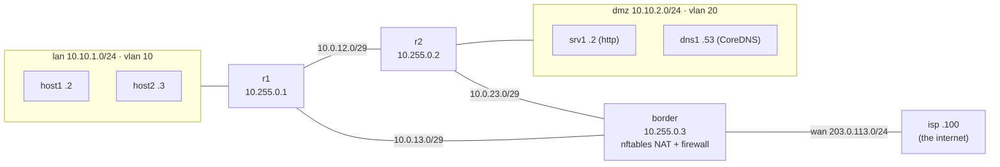
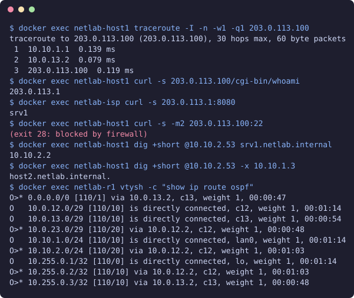

# netlab — IPAM + network as code

[](https://github.com/DYyyyDYyy/netlab/actions/workflows/ci.yml)

A small IPAM (FastAPI + PostgreSQL) is the single source of truth for a routed lab network.
Router (FRR/OSPF), firewall/NAT (nftables) and DNS (CoreDNS) configs are **rendered from IPAM
data** with Jinja2, deployed into Docker containers, and then **verified with real network
tools** (`ping`, `traceroute`, `curl`, `nft`, `dig`) from pytest.

## Topology



OSPF area 0 on r1/r2/border (p2p transit links, 1s/4s timers), border originates the default
route. The border does PAT for all inside prefixes, publishes `srv1:80` as `203.0.113.1:8080`
(DNAT), and drops everything else by default.

## Quick start

Needs Docker and [uv](https://docs.astral.sh/uv/).

```sh
make demo       # postgres + API -> seed IPAM -> render configs -> start 8 containers (~20 s warm, ~2 min cold)
make lab-test   # 19 network tests via docker exec
make test       # 40 unit/API/snapshot tests against a throwaway postgres
make lint       # ruff + mypy --strict
make down
```

API docs: <http://127.0.0.1:8000/docs> · metrics: `/metrics` · health: `/health`



## How it works

| Piece | Where |
|---|---|
| Data model: VRF, VLAN, device, subnet (`cidr`), address (`inet`) | [app/models.py](app/models.py), [migration](alembic/versions/0001_initial.py) |
| No overlapping subnets per VRF, enforced by `EXCLUDE USING gist (vrf_id WITH =, prefix inet_ops WITH &&)` | migration |
| Next-free allocation with a row lock (`SELECT … FOR UPDATE`), IPv4 /31 and IPv6 aware | [app/ipam.py](app/ipam.py) |
| Templates: `frr.conf`, `nftables.conf`, zone + reverse zone, `Corefile` | [templates/](templates) |
| Firewall policy as code | [app/policy.py](app/policy.py) |
| Lab topology seeded via the public API | [lab/seed.py](lab/seed.py) |
| Subnet → docker network, device → container, configs fetched from `/render/*` | [lab/deploy.py](lab/deploy.py) |
| Network tests (routing, PAT/DNAT, firewall, DNS, OSPF failover) | [tests/lab/](tests/lab/test_network.py) |

Ops: JSON logs, Prometheus metrics (request counters/latency, allocations, per-subnet
utilisation), multi-stage `uv` Dockerfile running as uid 10001, GitHub Actions with lint,
mypy, pytest against a Postgres service, image build, and the full lab + network tests.

Decisions: [ADR 1 inet/cidr + EXCLUDE](docs/adr/0001-inet-cidr-exclude.md) ·
[ADR 2 plain docker](docs/adr/0002-docker-not-containerlab.md) ·
[ADR 3 generated configs](docs/adr/0003-generated-configs.md) ·
[ADR 4 tests via exec](docs/adr/0004-network-tests-via-exec.md)

## What I learned

1. **OSI**: IPAM lives at L3; docker bridges are L2 segments; OSPF rides on IP proto 89; NAT rewrites L3/L4 headers.
2. **TCP/UDP**: firewall rules match L4 ports; `ct state established` lets replies back without opening inbound ports.
3. **Subnetting**: a /29 has 6 usable hosts, /31 has 2 (RFC 3021), IPv6 excludes the Subnet-Router anycast; Docker eats one address per bridge, so IPAM reserves it.
4. **Overlap** is a set problem — Postgres `&&` on `cidr` plus a GiST EXCLUDE makes it a DB guarantee, even under concurrency.
5. **NAT vs PAT**: SNAT maps many inside hosts to one WAN IP by rewriting source ports; DNAT publishes one inside service.
6. **masquerade vs snat**: masquerade is for a dynamic WAN address; with a static one `snat to` is correct (and needs no `nft_masq`).
7. **OSPF**: neighbors must reach Full, router-id from loopback, passive on host LANs, p2p on transit links, `default-information originate` on the border.
8. **Convergence**: having the prefixes is not enough — during adjacency build-up return traffic took the border, where conntrack saw a half flow and dropped it as `invalid`.
9. **Failover**: cutting r1↔border reroutes LAN→internet via r2 in a few seconds (dead interval 4 s).
10. **Docker networking**: Docker ≥ 28 drops routed traffic to container IPs from other bridges; lab networks use `gateway_mode_ipv4=nat-unprotected` so the routers, not the host, decide.
